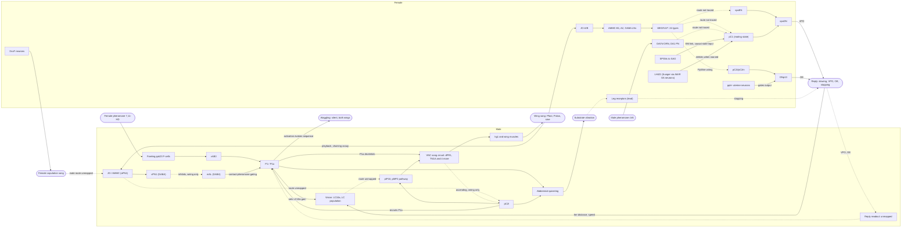

# Interspecies Communication Research Program

*2026-09-25 · 9 research tracks · 274 claims, all checked against live web search: 244 confirmed, 30 corrected, 0 dropped (148 [HIGH], 126 [MED] after cross-track harmonization) · gap-fill addendum (T10): 4 gaps, 32 claims kept after one skeptic review each (8 [HIGH], 24 [MED]) · [HIGH] finding visible in live search results, or confirmed by both round-1 verifiers with a live-search source · [MED] source confirmed but finding not directly visible, corrected, or single-verifier · [LOW] not located or unconfirmed · [CONFLICT] checks disagree · cited as [TAG · T<track>]; a bare (T<track>) marks a dossier's own synthesis, scope note or unverified lead*

> "Can we get a team to start working on research topics for better conversations with biological animals? Use some of the recent work on the fruit fly research and the brain mapping exercises to see if there is anything there for neurons lighting up for communication please."

## Short answer

- **Yes.** In fly courtship, identified neurons on both the sending and the receiving side have activity that tracks a communication signal. The evidence comes in four kinds:
  - *Recorded lighting up:* P1 in freely courting males; in singing males, pIP10 and the pMP2-containing descending pathway [HIGH · T04; pIP10 recording details MED · T01], and the nerve-cord neurons dPR1 (pulse only) and TN1A (pulse and sine) [HIGH · T04]. In listeners: AMMC-B1 (IPI selectivity) and pC2l/pC2m and DNp13 (song responses) [HIGH · T02]; A2 tracks synthetic vibration envelopes [HIGH · T02]; some of the 24 intermediate types were imaged and show a pulse-sine continuum [HIGH · T02]; vpoEN, vpoDN and female pC1 [HIGH · T04]; male vPN1 and pC1 [MED · T02]. For pheromones, P1 responds to female contact pheromones and to 7-T [HIGH · T03].
  - *Manipulated:* activating P1, pC2l, pIP10 or pMP2 drives song, and eight nerve-cord types are each needed for normal pulse song, sine song or both [HIGH · T01]. Activating P1/pC1 subsets in solitary males reproduces a stillness, waggling and song sequence [MED · T10]; waggling is a silent two-wing display that microphones miss [HIGH · T10]. vpoDN and DNp13 drive the female's two replies, vaginal plate opening and ovipositor extrusion [HIGH · T02], and female copulation song needs DsxF neurons [HIGH · T01].
  - *Wired only:* the mAL step in the vPN1-to-pC1 pathway, vpoEN's male partner pC1_6a, and male ascending neurons from song generators to song detectors appear only in the 2026 male connectome [MED · T02].
  - *Whole-brain maps:* song responses in 33 of 36 central-brain regions, mapped to regions rather than cell types [HIGH · T07].
- **No fly neuron has been recorded during a two-way exchange.** Among the audited dossiers, Flyception2 imaging of male P1 (and mAL) is the only recording made during a real two-fly interaction [HIGH · T04]. Outside flies, T06 finds turn-taking with recorded neurons in birds [HIGH · T06]. Bats add frontal cortex recorded in freely communicating groups [HIGH · T07] and correlated frontal activity across both brains of interacting pairs [HIGH · T08]; T08 notes that the correlation may reflect a shared context rather than exchanged information. T08 also reports marmoset frontal-cortex recordings during natural exchanges [MED · T08].
- **The receiver's state changes what a signal does.** Mating attenuates vpoDN's song responses, through pC1, and leaves vpoEN's unchanged. It also changes DNp13's motor output but not its song responses [HIGH · T02]. Hunger is a second state input: in starved females, octopaminergic AkhR neurons suppress receptivity through LH421 neurons that inhibit pC1 [HIGH · T10].
- **The male already runs a feedback loop.** He chooses fast pulse, slow pulse or sine song from the female's distance and movement [HIGH · T01] and his own motion [MED · T01], and three model-inferred internal states change that mapping [HIGH · T01]. In a 2026 closed-loop study his song triggered female backward walking, and he changed when he sang [MED · T01].
- **The new connectomes give wiring, not activity.** The male CNS connectome (166,700 neurons) [HIGH · T05] proposes, from wiring alone, a revision of an activity-based diagram: vPN1 is GABAergic, so its apparent drive of pC1 may be disinhibition through mAL [MED · T02]; untested by recordings or manipulations (T02). In theory and simulations, wiring alone is generally insufficient to predict activity when biophysical parameters are uncertain, and adding recordings from some neurons predicts the rest [HIGH · T05]; this has not been tested on fly communication data (T05). A wiring-only whole-brain model did make validated predictions, for feeding and grooming rather than communication [HIGH · T05].
- **No audited work shows AI decoding what animal signals mean (T07).** Evidence about meaning comes from receiver tests, such as zebra finch confusions that follow meaning over acoustics [HIGH · T07].
- **Plan.** Start computational work this week (R4-R7), building toward a contingent-versus-yoked song partner with a vpoDN/pC1 readout (R1) and a machine that replies to a singing male (R2). The target is a well-timed, state-aware exchange rather than translation (T08). Staffing, data access and approvals are set out under Team, resources and approvals; R10's finch work waits until an animal ethics committee has classified the protocol (T10).

## The fly courtship conversation, neuron by neuron

Solid arrows: recorded or causal evidence. Dotted arrows: wiring-only links, unverified leads or unmapped routes. WED-to-pC2l is dotted because the link comes from FlyWire wiring, although both ends were recorded responding to song [HIGH · T02]; Or67d-to-pC1 is dotted because female pC1 responds to cVA [HIGH · T03] but no dossier traces the route from the DA1 projection neurons to pC1. The SAG-to-pC1 edge is solid because silencing the SPSN-SAG pathway mimics the mated state [HIGH · T03]; the specific SAG-to-pC1 synapses come from EM (T03). The solid mAL-to-P1 edge is contact-pheromone gating (Clowney et al. [MED · T03]), separate from the wiring-only vPN1-to-mAL step in male hearing [MED · T02]. Male pC2l responds to sound [HIGH · T01], but no dossier traces its auditory input.

| Stage | Cell types | Sex | Recorded activity? | Causal test? | Connectome wiring? | Confidence | Track |
|---|---|---|---|---|---|---|---|
| Male vision | LC10a; LC population | M | LC10a gain rises in courtship | Silencing impairs tracking | Male optic lobe | MED; HIGH (optic lobe) | T03, T04, T09 |
| Male contact chemosensing | ppk23 F/M-cells, vAB3, mAL | M | Cells respond to 7,11-HD or 7-T; P1 excited or inhibited | ppk23 and Gr32a needed | Not in FlyWire (no leg neurons) | HIGH (P1, Gr32a); MED (rest) | T03 |
| Volatile pheromone | Or67d ORN, DA1 PN, DC1, DN1 | Both; M (DN1) | DN1 and female pC1 respond to cVA | Or67d needed | DA1 PNs traceable in FlyWire | HIGH (Or67d, pC1); MED (path) | T03 |
| Male decision | P1/P1a; pC2l | M; both (pC2l) | P1 active in courtship, not at copulation; pC2l responds to sound, vision | P1 drives persistent song; pC2l pulse then sine | pC1 types in male CNS | HIGH; MED (wiring) | T01, T04 |
| Descending | pIP10; pMP2 | M | Nested: pIP10 in both songs, pMP2 pathway pulse only | pIP10 gives pulse and sine; pMP2 pulse | Structured input to VNC | HIGH; MED (per-song detail) | T01, T04 |
| Nerve-cord song circuit | dPR1, TN1A, vPR9, dMS2, dMS9, vMS12 | M | dPR1 pulse only; TN1A both | Each needed for pulse, sine or both | MANC: two nested pathways | HIGH | T01, T04 |
| Vibration sender | P1a, pC2l | M | No | Drive vibration via separate premotor pathways | Not covered | MED (T01, T05; harmonized) | T01, T05 |
| Silent wing display | Waggling (both wings, about 10.6 Hz); P1/pC1 subsets | M | No; behaviour only | P1/pC1 activation evokes stillness, waggling, then song | Not covered | HIGH (behaviour); MED (activation) | T10 |
| Female ear and relay | JO-A/B; AMMC-B1, A2, GABA LNs | Both | JON adaptation; B1 IPI selectivity | Only aPN1, aLN(al) of 12 needed | Baker 2022: FlyWire links from the 24 types to known early auditory neurons, including B1 | HIGH; MED (JO) | T02, T04 |
| Intermediate layer | 24 WED/VLP types | F (connectome) | Pulse-sine continuum | None described | FlyWire: non-hierarchical, predicted signs | HIGH | T02, T05 |
| Song detectors | pC2l/pC2m | Both | Tuned to several pulse-song features | Silencing reduces female slowing | Direct pC2l-to-DNp13 synapses | HIGH; MED (manipulation) | T02 |
| State integrators | vpoEN; pC1, pCd; pC1d/e, aIPg | F | vpoEN unchanged by mating; pC1 responds to song, cVA | pC1/pCd set receptivity; pC1d/e sets minutes-long state | Onto vpoDN; pC1d/e-aIPg loop | HIGH | T02, T04 |
| Mating-state input | SPSNs; SAG | F | Not shown | Silencing mimics mated state | SAG to pC1 (EM) | HIGH | T03 |
| Hunger input | AkhR octopaminergic neurons; LH421 | F | Not shown | Starvation suppresses receptivity; LH421 inhibits pC1 via GABA/Rdl | Not covered | HIGH | T10 |
| Reply neurons | vpoDN; DNp13; ppk+ uterine | F | vpoDN responses fall after mating; DNp13's do not | vpoDN drives VPO; DNp13 drives OE | Direct pC2l-to-DNp13 synapses; vpoEN and pC1 inputs reported in EM, dataset unconfirmed (T03) | HIGH | T02, T04 |
| Female sender | DsxF neurons | F | No | DsxF neurons needed for copulation song; seminal fluid modulates it | Not covered | HIGH (T01, T06); MED (T10) | T01, T06, T10 |
| Female vibration sensing | Leg neurons (unverified lead) | F | No | Behaviour only: females stop | BANC (lead) | MED | T03 |
| Male hearing and routing | vPN1, mAL, pC1; pC1_6a | M | vPN1 prefers long IPIs; pC1 tuning matches chaining | Inactivation disrupts chaining | vPN1-to-mAL disinhibition (wiring only); sex-specific partners | MED | T02, T07 |

**Where the dossiers disagree.**
- *vPN1 tuning (resolved).* vPN1 prefers long inter-pulse intervals [MED · T02; HIGH · T07]. T07 had reported short intervals; the consistency check confirmed long intervals in the Zhou et al. 2015 abstract, and T07 is corrected.
- *vpoEN and pulse song.* T06 says vpoEN respond to pulse song [MED · T06], and T05 says vpo neurons prefer pulse over sine [MED · T05]. T03 removed "pulse song specifically" as unsupported [MED · T03]. The program says vpoEN are tuned to features of D. melanogaster courtship song [HIGH · T02], with pulse-specific tuning unconfirmed. T02's statement that EM data confirmed vpoEN's inputs is narrowed to "reported", because T03's audit could not see the dataset.
- *The state-switching neurons.* Calhoun et al. 2019 activated a neuron pair previously described as song command neurons (likely pIP10; confirm in the full text), which was sufficient to drive switching between states. T01 and T05 tagged this [HIGH] and T06 and T07 named the pair pIP10 at [MED]. No dossier saw the identity, so the program uses one tag, [MED · T01, T05, T06, T07].
- *Ovipositor extrusion.* Wang et al. treat it as rejection by mated females [MED · T02]; Mezzera et al. report that it promotes copulation attempts in virgin and mated females and signals acceptance in virgins [HIGH · T02].
- *BANC size (resolved).* T09 had given about 188,000 neurons and 199 million synapses, and T05 about 160,000 neurons. Search supports about 160,000 (158,262 in coverage of the Nature paper), and T09 is corrected. Take the synapse count from the paper.
- *Retention of the 2026 song changes.* T01's audit reports that males' changes in when they sang were retained at first and then gradually reverted [MED · T01]. T06 had said the males kept the changes and now follows T01. Search confirmed the authors' "usage learning" framing but not the time course, so read retention from the full text before relying on persistence.
- *Tag harmonization.* Several findings carry different tags in different dossiers. The program rule: if any track's live audit saw a finding, it may be cited at [HIGH] wherever the same paper is cited for that finding; otherwise it is [MED] everywhere. The consistency check applied the rule inside the dossiers to 13 claims (8 raised, 5 lowered), and `evidence/claims-ledger.json` records both the audit tag and the harmonized tag. Examples: the male CNS counts are [HIGH] (T09 had tagged them [MED]); the P1a/pC2l vibration pathways are [MED] (T05 had tagged them [HIGH]; the neuron names were not visible); and the state-switching pair is [MED].

## What "lighting up" has and has not been shown

The program separates neurons **recorded** responding, neurons **manipulated** to test cause, and neurons only **wired** in a connectome; a wiring route is no evidence that a neuron lit up.

**Shown.** The table's recordings come from separate studies of genetically targeted types, mostly in head-fixed or tethered flies [HIGH · T04]. Receiver selectivity builds in stages, from AMMC-B1 interval selectivity to pC2 tuning, and females integrate song over tens of seconds [HIGH · T02].

**Whole-brain maps and the cell-type gap.** Pan-neuronal imaging finds song-tuned activity in most central-brain regions. Responses are stereotyped early in the pathway and more variable at higher stages. The units are regions, not cell types [HIGH · T02]. Light beads microscopy reaches 28 volumes/s and recovers single song pulses with temporal super-resolution [MED · T04]. No audited claim matches whole-brain activity to connectome cell types (T04, T09). The route is coarse: BIFROST registration with under 10 µm error, candidates among 8,453 FlyWire types (a third of hemibrain types were not re-identified), then NeuronBridge and 3,060 split-GAL4 lines for targeted re-imaging. No audited claim describes an adult-fly identity label comparable to C. elegans NeuroPAL (T04); NeuroPAL resolves all C. elegans neuron identities [HIGH · T04]; the annotated whole brain is female while the senders are male [HIGH · T04].

**Confounds and limits of wiring.** Walking raises activity brain-wide, and most neurons track running and flailing, so communication responses need locomotion-matched controls. In C. elegans, signal propagation departs from anatomy, partly through extrasynaptic signalling [HIGH · T04].

**State dependence.**
- Mated females' vpoDN responds weakly to song, and 5-s pC1 photoactivation restores its sensitivity and receptivity [HIGH · T04].
- Activating pC1d/e sets a state lasting minutes [HIGH · T04].
- Mating gates dopaminergic modulation of the auditory receptor neurons [MED · T02].
- In males, P1 activity tracks pursuit and gates LC10a gain [MED · T04], and P1 activation produces a persistent aggressive state [HIGH · T01].
- Acute cVA raises aggression through Or67d, and chronic exposure lowers it through Or65a [HIGH · T03].
- Hunger lowers female receptivity: octopaminergic AkhR neurons act on Octβ1R-expressing LH421 neurons, which inhibit pC1 through GABA and Rdl [HIGH · T10].
- Male mating drive appears to vary slowly and is linked to dopamine. A recurrent pCd-NPF loop raises a dopamine signal that increases courtship; its activity builds with abstinence, falls with each mating, and in the authors' model recovers over about 3 days [MED · T10]. Near copulation, dopamine acting through Dop2R suppresses the visual threat pathway [MED · T10].
- State can in principle be imaged directly. Red GRAB dopamine sensors work alongside GCaMP6s in live flies [HIGH · T10], and GRAB_OA1.0 reports octopamine release in the mushroom body [MED · T10]. Neither has been used during courtship (T10).

A decoder or partner needs the receiver's state as an input. The plan so far uses only mating status and model-inferred states; satiety, time since the male's last mating and a neuromodulator readout are candidate measured channels (T10).

**Not shown.** No fly study has recorded neurons during a contingent exchange or in both partners (T04, T06); outside flies, both duetting wrens' HVC [HIGH · T06] and both bats' frontal cortex in interacting pairs [HIGH · T08] have been recorded. Also unshown: how far pIP10 activity leads song, which cells separate fast from slow pulse (T01), the aggression-song neurons [HIGH · T01], the neurons producing female copulation song beyond DsxF [HIGH · T01], female vibration receptors beyond an unverified lead, how males read female replies (T03), and male brain activity matched to male-connectome types (T04). For the pIP10 lead, indicator kinetics limit the estimate. After a single spike, the most widely used GCaMPs half-rise in about 100 ms in mouse neurons [MED · T10], the same order as the lead being sought. No voltage imaging of song neurons exists, although near-whole-brain ArcLight imaging at up to 200 Hz has been done in adult flies [HIGH · T10].

## What the new connectomes add

- **FlyWire (female brain).** 139,255 proofread neurons, about 5×10^7 synapses, 8,453 types, released through CAVE [HIGH · T09]. The version labels v630 and v783 are unconfirmed (T09). It holds the first auditory circuit map [HIGH · T02]. It has no nerve cord, no leg neurons and no P1 [MED · T03]. Type-level wiring is largely reproducible across two female brains, but single connections vary [MED · T09].
- **MANC (male nerve cord).** About 23,000 neurons, with descending, premotor and wing-motor annotation [MED · T09]. It resolved the eight-type song network into two nested feed-forward pathways [HIGH · T01]. How older driver-line names map onto its types is unsettled [MED · T01].
- **BANC (female brain plus cord).** Local sensory-effector loops linked by ascending and descending modules [MED · T05], with a Nature 2026 version reported [MED · T09]. It has about 160,000 neurons (158,262 in coverage of the Nature paper) [MED · T05]; an earlier 188,000 figure in T09 was an error, corrected by the consistency check. Take the synapse count from the paper. T03 proposes using it to trace female leg inputs toward pC1, vpoDN and DNp13 (unverified lead, T03).
- **Male CNS (Cell, 3 September 2026).** One male's brain and nerve cord: 166,700 neurons and 11,710 types, annotated for fruitless and doublesex. Against the female brain it has 8,069 isomorphic, 138 dimorphic, 289 male-specific and 71 female-specific types [HIGH · T05; harmonized from MED in T09]. Dimorphic types concentrate in higher-order centres; the sensory and motor periphery is largely isomorphic [MED · T03]. It is the only dataset holding both the song-producing and the song-hearing circuits of the singing sex (T05). Its wiring-only predictions:
  - disinhibition from vPN1 through mAL to pC1;
  - a vpoEN "switchboard" with the shared partner DNp55, vpoDN in females and pC1_6a in males;
  - ascending neurons from song generators to song detectors, so singing may change hearing [MED · T02];
  - a proposed vPN1-mAL-pC1 module that switches between courtship and aggression (unverified lead, T01).
- **Also new.** A preprint types about 13,000 female VNC neurons by alignment [MED · T01]; an unverified lead says it predicts a new song type, IN03B024, inhibiting pMP2 and dPR1 (T09).

**Limits.** Wiring is not activity, and each connectome comes from one animal [MED · T01]. The transmitter classifier is 94% accurate per neuron [HIGH · T05], so about 6% of neurons would carry a wrong label into models (T05 inference); it has no neuropeptide class (T05). Inferred peptidergic edges have been added to FlyWire only for single subnetworks: the clock network [HIGH · T10] and about 80 neurosecretory cells [MED · T10]. Validated whole-brain model predictions concern feeding and grooming, not communication [HIGH · T05]. The dossiers describe that model's scope differently, central brain [HIGH · T05] versus whole FlyWire brain [HIGH · T09]. The consistency check recalls the Nature abstract as describing a leaky integrate-and-fire model of the entire brain. T09 adds that it is built from connectivity and predicted transmitter identity, with global parameters taken from the literature. Confirm the abstract before stating scope.

## From flies to conversations with animals

Track 06's six-level ladder is an organizing device [LOW · T06].

| Level | Flies today | Other species today |
|---|---|---|
| L1 Eavesdrop | DAS and SongExplorer annotate song [HIGH · T07]; waggling needs video, because microphones miss it [HIGH · T10] | NatureLM-audio zero-shot classification; DeepSqueak [HIGH · T07] |
| L2 Decode signal to context or state | Female cues map to song mode under three hidden states [HIGH · T01] | Bat calls carry emitter and context; elephant receiver predicted at about 27.5%; sperm whale coda structure [HIGH · T07]; marmoset "names" [MED · T07], contested [HIGH · T07] |
| L3 Open-loop playback | Conspecific-interval song speeds mating [MED · T06] | Elephants respond more to calls addressed to them; finch confusions follow meaning [HIGH · T07] |
| L4 Contingent reply | 2026 song-triggered female backing [MED · T01] | Finches time calls around a vocal robot; humpback "Twain", one whale; robots steer cockroach groups [HIGH · T06] |
| L5 Co-adaptation | Males changed singing contexts after feedback [MED · T01] | Robot-linked bee and zebrafish groups coordinate [HIGH · T06] |
| L6 Neural read/write in the exchange | Open-loop activation only [MED · T06] | Finch HVC inhibition sets reply timing; wren duets recorded in HVC [HIGH · T06]; bat frontal cortex recorded in freely communicating groups [HIGH · T07] and correlated across both brains of interacting pairs, possibly from shared context [HIGH · T08]; marmoset frontal cortex in exchanges [MED · T08]; one-bit brain-to-brain links: rat-to-rat decoder at about 60-70% [MED · T06], human EEG to rat tail at about 94% [HIGH · T06] |

Flies sit at L2-L3 plus open-loop L6, with one L4-L5 precedent of uncertain durability. T01's audit reports that the males' changes were retained at first and then gradually reverted [MED · T01]. Read the time course in the full text.

What carries over from flies is algorithms and methods, not homologous neurons (T08). Temporal-pattern filtering has counterparts in the cricket's five-neuron delay-line and coincidence detector and in bat colliculus neurons that cluster by call category [HIGH · T08]. Reply timing set by inhibition [HIGH · T08] and activity that precedes calling [MED · T08] have no fly counterpart in T08's claims. Comparing mouse PAG-USV gate neurons with fly command neurons is the researcher's analogy [LOW · T08].

## Research agenda

**How we ranked.** Score = value × feasibility. Value (1-3) is how directly a topic moves the program toward contingent, neurally grounded exchange; feasibility is 3 for computational work now, 2 for wet lab over months, 1 for years. Ties go to higher value, then to topics others depend on. R1-R3 climb the ladder; R4-R7 start this week and feed them. The two-brain linked-VR moonshot (T03, T06) scores 3 and sits outside the list.

| Rank | Topic | Value | Feasibility | Score |
|---|---|---|---|---|
| R1 | Contingent versus yoked song partner | 3 | 2 | 6 |
| R2 | Machine reply to a singing male | 3 | 2 | 6 |
| R3 | Injected female "yes" and "no" | 3 | 2 | 6 |
| R4 | Fit-then-predict digital receiver | 2 | 3 | 6 |
| R5 | Conversation metrics, state-aware decoding | 2 | 3 | 6 |
| R6 | Song-ROI to cell-type census | 2 | 3 | 6 |
| R7 | Two-sex cross-connectome atlas | 2 | 3 | 6 |
| R8 | Testing male-connectome predictions | 2 | 2 | 4 |
| R9 | The vibration channel | 2 | 2 | 4 |
| R10 | Cross-species transfer pilots | 2 | 2 | 4 |

### Team, resources and approvals
No dossier covered staffing, a fly facility, rigs or approvals. The gap-fill pass searched data access, rig precedents and approvals; it did not search staffing, a fly facility or a stock budget, which remain open (T10).

- **Roles.** The agenda needs at least a computational modeller (R4, R6, R7), a fly geneticist and two-photon imager (R1-R3, R8), a real-time rig engineer (R1, R2), a bioacoustics and machine-learning lead (DAS, the mode and waggling classifiers, R5), and a welfare and ethics lead (Guardrails, R10) (T10).
- **Data access.** The Pacheco 2021 auditory dataset is public on Princeton DataSpace with no listed restrictions. It holds across-trial median responses from 33 flies, plus 5 flies with natural song [HIGH · T10]; raw volumes would need the authors. BIFROST has a Dryad deposit and a Snakemake workflow [MED · T10], but whether the deposit holds the atlas templates is unconfirmed. Stern-lab courtship song audio (6.75 GB) is on Dryad [HIGH · T10], and SLEAP flies13 gives pose without audio [MED · T10]. No public dataset pairing song with both flies' poses was found. A Murthy-lab courtship deposit on Princeton DataSpace (doi 10.34770/me8y-8k48, contents unverified) is the lead to check before asking the Murthy or Stern labs for a data-sharing agreement [MED · T10].
- **Rigs and partners.** A 32-channel song-recording design with open-source segmentation software is published [MED · T10]. Tethered males court a virtual female in closed loop during two-photon imaging [MED · T10], and optogenetically primed tethered males follow moving spots while pC1 calcium rises with each turn [MED · T10]. Neither precedent gives component lists or costs. The Ruta lab (tethered courtship VR) is a candidate partner for R1 and R2, and the Murthy and Stern labs for paired song-and-pose data (T10).
- **Approvals.** Insect work proceeds under the voluntary welfare protocol in Guardrails. R10's finch work is vertebrate research. In the UK, a procedure is regulated if it may cause harm at or above the level of introducing a needle, and a regulated procedure needs project and personal licences and a licensed establishment. In the US, an approved IACUC protocol is normally needed for any vertebrate use [MED · T10]. Whether playback alone is regulated in the UK depends on the protocol, so the finch rig waits until the institution's ethics committee (AWERB advice in the UK, IACUC in the US) has classified it (T10).

### R1. Contingent versus yoked song partner
**Why:** The decisive test is missing (T06): an artificial partner that answers the female, compared with a yoked replay of the same song. vpoDN responds to song and triggers acceptance [HIGH · T04].

**Key question:** Hypothesis: song whose timing, mode and amplitude follow her movement raises plate opening and slowing more than the yoked replay.

**First 90 days:** Build the yoked rig. Calibrate level at the female, since antennal tuning depends on amplitude [MED · T02]. Run preregistered behaviour-only arms in virgin and mated females.

**Data and tools:** DAS for closed-loop song detection [HIGH · T06]; SLEAP real-time pose [MED · T06]; GLM-HMM song policy [HIGH · T01]; vpoDN/pC1 imaging later, with an optional state arm using red GRAB dopamine sensors alongside GCaMP6s [HIGH · T10], not yet validated in courtship (T10).

**Feasibility:** Wet lab, months.

**Tracks:** T02, T04, T06, T09, T10.

### R2. A machine that replies to a singing male
**Why:** The only fly L4-L5 precedent used song-triggered female Moonwalker activation [MED · T01]. Males use three defined song modes [HIGH · T01], and no real-time mode classifier is among the audited sources (T01). Males also perform waggling, a silent two-wing display that follows mutual stillness and precedes song [HIGH · T10], so a microphone-only classifier misses a class.

**Key question:** Hypothesis: a reply that depends on whether he just sang fast pulse, slow pulse or sine shifts his mapping within a session. How long does the shift last?

**First 90 days:** Check the 2026 methods, since the Moonwalker step was not visible in live search, and reproduce the result. Benchmark DAS mode detection against a 50 ms target (T07), add video-based classes for waggling and pre-song stillness (T10), and measure retention. In parallel, read the indicator, frame rate and onset method from the Shiozaki 2024 Methods, which search did not show [MED · T10]. Then estimate how far pIP10 calcium [MED · T01] leads song onset with an indicator forward model, and report the lead with bounds, so a later phase can answer intent. The most widely used GCaMPs half-rise in about 100 ms after a single spike [MED · T10], the same order as the lead sought, and the standard deconvolution benchmark scores spike correlation, not onset timing [MED · T10]. If the bounds are too wide, plan re-imaging with jGCaMP8f or 8m, which rise faster than jGCaMP7f in fly larval boutons [MED · T10]. The same kinetics set the latency budget for any closed loop on neural signals (T10).

**Data and tools:** DAS; GLM-HMM; pose tracking for the waggling class; Moonwalker split-GAL4 lines or a robotic dummy.

**Feasibility:** Wet lab, months; the intent analysis is computational.

**Tracks:** T01, T04, T06, T07, T10.

### R3. Injecting the female's "yes" and "no"
**Why:** The return arm of the loop is unmapped (T03). vpoDN and DNp13 drive plate opening and extrusion [HIGH · T02]. Wang et al. report that extrusion deters males only when mated females perform it [MED · T02; MED · T03], while Mezzera et al. find it promotes copulation attempts and signals acceptance in virgins [HIGH · T02].

**Key question:** Hypothesis: activating vpoDN or DNp13 shifts male song, copulation attempts, and P1 and LC10a-pathway activity, and so reveals the male's receiving circuit.

**First 90 days:** Behaviour only. Apply female-restricted CsChrimson to virgin and mated females paired with wild-type males. Add a playback arm with female copulation song, the only natural female acoustic signal in the dossiers. Playback lengthens the female's remating interval, and males that hear it gain reproductive success under competition [HIGH · T01]. The song follows acceptance, so this arm tests male reception of a female signal rather than a pre-mating reply (T06).

**Data and tools:** Split-GAL4 lines, with coverage checked line by line [MED · T09]; DAS; SLEAP.

**Feasibility:** Wet lab, months.

**Tracks:** T01, T02, T03, T06, T10.

### R4. Fit-then-predict digital receiver
**Why:** In connectome-constrained simulations, wiring plus partial recordings predicts unrecorded neurons [HIGH · T05]; R4 tests whether this holds for song. Recorded tuning of the imaged subset of the 24 intermediate types [HIGH · T05; coverage per T02] and of pC2l and vpo neurons [MED · T05] is the benchmark that no connectome simulation has yet reproduced (T05). A validated receiver would pre-score songs for R1.

**Key question:** Hypothesis: an unfitted model driven by JO-A/B input gets the direction of the pulse/sine preferences right but not their size. How many recorded types does fitting need?

**First 90 days:** Extract the JO-A/B paths to pC2l and vpoEN, add an adapting front end, and sweep pulse interval. Carry synapse sign, including the mAL step [MED · T02]. Size the imaging with teacher-student simulations.

**Data and tools:** FlyWire; male CNS; Shiu model code, which is not validated for courtship [HIGH · T09]; connconstr (URL not verified). Peptidergic edges inferred for the clock network [HIGH · T10] and about 80 neurosecretory cells [MED · T10] can be added, labelled inferred rather than measured (T10).

**Feasibility:** Computational, now.

**Tracks:** T02, T05, T09.

### R5. Conversation metrics and state-aware decoding
**Why:** An association pipeline flagged relationships in 34.5-84.3% of randomised bonobo datasets [MED · T07], and the claimed courtship-song rhythm failed re-recording, which its original authors dispute [HIGH · T06]. Because extrusion's meaning depends on mating state [MED · T03], a state-blind decoder would be expected to misread it (hypothesis, T03).

**Key question:** Hypothesis: state-aware models predict the next reply better than state-blind ones, and transfer entropy shows two-way influence under shuffled and yoked controls.

**First 90 days:** Locate song annotations paired with both flies' tracks. No public dataset was found (T06; T10); check the Murthy-lab DataSpace deposit first [MED · T10], then seek a data-sharing agreement. Until then, fit pose-only models on flies13 and song-only models on the Stern-lab recordings. Once paired data are in hand, fit GLM-HMMs with and without mating status, add time since the male's last mating as a drive covariate, a proxy suggested by the pCd-NPF loop [MED · T10] (T10 inference), and reimplement the dependence-aware permutation test.

**Data and tools:** SLEAP flies13 videos [MED · T09], pose only [MED · T10]; Stern-lab Dryad song audio [HIGH · T10]; DAS; GLM-HMM.

**Feasibility:** Computational, now, for single-channel metrics; paired analyses depend on data access.

**Tracks:** T03, T06, T07, T09, T10.

### R6. Song-ROI to cell-type census
**Why:** This is the main data gap. Song maps are region-level [HIGH · T02], although a registration route exists [HIGH · T04].

**Key question:** Hypothesis: most song-tuned ROIs narrow to five or fewer FlyWire candidate types (T04).

**First 90 days:** Place the Pacheco 2021 ROIs in atlas space with BIFROST, rank candidates by morphology and tuning, and flag types FlyWire could not re-identify.

**Data and tools:** Pacheco 2021 median responses, public on Princeton DataSpace [HIGH · T10]; BIFROST Dryad deposit and Snakemake workflow, with template contents unconfirmed [MED · T10]; FlyWire; NeuronBridge.

**Feasibility:** Computational now on the median responses; atlas registration depends on confirming the BIFROST templates, and raw-volume reanalysis needs the authors; wet-lab validation later.

**Tracks:** T02, T04, T09, T10.

### R7. Two-sex cross-connectome atlas
**Why:** Each sex now has a whole-CNS connectome from one animal, and single connections vary between animals [MED · T09]. Non-song channels converge on P1 and pC1 (T03).

**Key question:** Hypothesis: communication circuits are conserved at cell-type level, and dimorphic types sit at convergence points rather than at sensors.

**First 90 days:** Export named types and two-hop partners from the five connectomes T09 names: FlyWire, hemibrain, BANC, MANC and the male CNS, with the male optic lobe for visual wiring. Add the male CNS dimorphism labels, mark each edge activity-confirmed or wiring-only, and publish a versioned table. Add FANC, the female nerve cord, which T09 did not cover: the female cord carries VPO and OE output, and female copulation song may use song-capable cord circuits (T01 open question).

**Data and tools:** CAVE and neuPrint [MED · T09].

**Feasibility:** Computational, now.

**Tracks:** T01, T02, T03, T09.

### R8. Testing male-connectome predictions
**Why:** The switchboard, ascending-feedback and mAL predictions are wiring only [MED · T02]. If singing changes hearing, a two-way rig must account for the animal's own sound (T02).

**Key question:** Hypothesis: silencing mAL removes vPN1's drive of pC1, and self-singing reshapes song-detector responses.

**First 90 days:** Query the targets of the ascending neurons, look for split-GAL4 lines, and image vpoEN and pC1_6a in males during playback.

**Data and tools:** Male CNS; NeuronBridge; FlyLight.

**Feasibility:** Wet lab, months; lines may need building.

**Tracks:** T01, T02.

### R9. The vibration channel
**Why:** The brain neurons that drive song also drive substrate vibration, through separate premotor pathways [MED · T01, T05]. Females stop when they feel it [MED · T03]. The female receptors are known only from an unverified 2021 lead (T03).

**Key question:** Hypothesis: specific leg neurons reach pC1 or locomotor-arrest circuits through identifiable ascending neurons.

**First 90 days:** Trace the 2021 paper's neurons in BANC, and pilot 4-6 Hz playback to walking females.

**Data and tools:** BANC; vibmodel code (URL not verified).

**Feasibility:** First step computational; then wet lab, months.

**Tracks:** T01, T03, T05.

### R10. Cross-species transfer pilots
**Why:** Three systems are ready: zebra finch reply timing depends on HVC inhibition, male C. elegans CEM neurons mediate attraction to ascr#8, and the cricket detector has a fitted model [HIGH · T08].

**Key question:** Hypotheses: fly and cricket detectors share a pulse-interval algorithm, and inhibition-based reply timing sustains better-timed finch exchanges than fixed-delay playback.

**First 90 days:** Run the computational cricket-fly benchmark once the model code is confirmed available, and check whether NeuroPAL identifies male CEM. Submit the finch call-rig protocol for ethics classification before building the rig (T10).

**Data and tools:** Cricket model (cricketnet code, unaudited in T08); FlyWire; GCaMP+NeuroPAL strains.

**Feasibility:** Benchmark now if the code is available; the finch pilot waits for ethics classification [MED · T10]; pilots wet lab, months.

**Tracks:** T06, T08, T10.

## Start this week

Items 1-3 and 6 use public data and tools named in the dossiers or found in the gap-fill pass. Items 4 and 5 are conditional on access, as marked. Log every dataset version [MED · T09].

1. **Communication-circuit export (R4, R7).** With CAVE and neuPrint tokens [MED · T09], export every cell type in the table above, with its two-hop partners, from FlyWire and the male CNS. Label each edge recorded, causal or wiring-only.
2. **In-silico playback (R4).** Install philshiu/Drosophila_brain_model, confirming its default materialization and licence in the README (T09). Reproduce one published feeding or grooming result, then drive Johnston's organ subtypes with pulse- and sine-like patterns and rank responders against pC2l and vpoEN tuning.
3. **Conversation-metrics pipeline (R5).** Locate paired audio and pose data: check whether the Murthy-lab courtship deposit on Princeton DataSpace (doi 10.34770/me8y-8k48) pairs song with both flies' tracks [MED · T10]. Until paired data are in hand, limit the pipeline to pose-only metrics on SLEAP flies13, which has no audio [MED · T10], and to song-only statistics from DAS on the Stern-lab Dryad recordings [HIGH · T10]. Fit GLM-HMMs and compute transfer entropy against shuffled controls only once both channels come from the same pairs.
4. **ROI census pilot (R6; conditional on BIFROST templates).** Download the Pacheco 2021 median responses from Princeton DataSpace, which lists no restrictions [HIGH · T10]. Confirm that the BIFROST Dryad deposit holds the atlas templates [MED · T10], or request them from the authors, before placing song-tuned ROIs in atlas space.
5. **Cricket-fly detector benchmark (R10; conditional on code access).** Reproduce cricket pulse-period tuning with the published fitted model [HIGH · T08], once its code (cricketnet, unaudited in T08) is confirmed available. Then search FlyWire for an inhibitory neuron feeding a delayed excitatory neuron onto a shared target (T08).
6. **Staffing, partners and approvals.** Fill the five roles under Team, resources and approvals, write the voluntary insect welfare protocol (T09), contact candidate partner labs for paired data and tethered-courtship rigs, and submit R10's finch playback protocol for ethics classification (T10).

## What would count as a real "conversation" milestone

These do not count: next-sound prediction (DolphinGemma has no evaluation of meaning) and repertoire statistics [HIGH · T07], a single-animal exchange [HIGH · T06], one-bit brain-to-brain links, or open-loop driving of a sender's neurons [MED · T06].

The program adopts a staged definition:
1. **Contingency.** The animal responds differently to a partner that answers it than to an exact yoked replay. The test is preregistered and blinded, with shuffled and acoustically matched controls (T06, T07).
2. **Neural grounding.** Over several turns the agent chooses each signal from the animal's last one, and its reply produces a predicted, receiver-specific change in identified neurons and behaviour that beats the controls. T07 proposes Drosophila first, then zebra finches or Egyptian fruit bats (T07).
3. **Co-adaptation with retention.** The sender's mapping shifts and retention is measured, because T01 reports that the 2026 changes reverted [MED · T01] and the time course is unconfirmed.
4. **Breadth.** Yovel and Rechavi require the animal's own signals, no new signals for it to learn, and many behavioural contexts [MED · T09]. Fly courtship covers one context, so it is a methods testbed against that bar (T09).

Trials are not independent, because brief pC1 activation shifts responses for minutes [MED · T06]. Because reply timing is actively controlled [HIGH · T08], score turns per exchange, overlap rate and latency adaptation (T08 recommendation), and control for entrainment, habituation and pseudo-replication (T06).

## Guardrails

- **Welfare.** Insects fall outside the UK Sentience Act [MED · T09]. The New York Declaration includes insects among animals with a realistic possibility of conscious experience, and a systematic review found strong evidence of pain-relevant capacities in adult flies [HIGH · T09]. Write a voluntary welfare protocol (animal numbers, stimulus intensity, stop rules) before running R1-R3 (T09). R10's finch work is vertebrate research and needs institutional classification and approval before any rig is built [MED · T10].
- **Wild playback.** Rutz et al. warn that AI-generated playback risks disrupting wild animals' behaviour and cultures, and call for guidelines [MED · T09]. An ethics analysis lists the risks to animal communities [MED · T07]. No synthetic alarm-like or name-like signal goes to wild animals without independent review and permits (T06, T07).
- **Dual use.** Trellis-wire vibrations cut leafhopper mating to 4% in a vineyard [HIGH · T09]. Female flight-tone lures (about 484 Hz) passively trap male *Aedes aegypti*, improving collection for surveillance; the study did not test population control [HIGH · T09]. Pest-signal work needs a non-target assessment. Published rare-species locations have aided poachers [HIGH · T09], so obscure sensitive sites.
- **Hype checks.**
  - Never call classification or next-sound prediction translation.
  - Eon's digital fly reads hand-picked descending neurons as turn, walk, groom and feed commands [HIGH · T05]. flymsg's 29 checks are self-defined [MED · T05].
  - Wiring is not activity [MED · T01], and one connectome is not the species norm [MED · T09].
  - Most identity-resolved courtship results come from three labs; replication is open (T04).

## How this was produced

**Team.** AI agents defined as workflow scripts in `team/`, with tagging done in code (`team/README.md`):
- per track: a researcher, a source-fidelity verifier, an adversarial skeptic and a dossier writer;
- for the audit: a live auditor, a second-opinion checker and a revision writer;
- for the program: this program lead, a consistency checker, a completeness critic, gap-fill researcher and skeptic pairs, and two editors.

**Three verification rounds.**
1. **Round 1.** Per track, two verifiers independently checked the researcher's claims.
2. **Round 2.** A live auditor checked all 274 claims against live search results, in two passes because of the search cap. No claim was contradicted, so no second opinion was needed.
3. **Round 3.** A cross-dossier consistency check and a completeness critic reviewed this overview. The critic named four gaps. Each was researched with live search by one agent and reviewed by one skeptic, and a gap claim is [HIGH] only when both saw the finding. The 32 kept claims are in `tracks/10-gap-fill-addendum.md`. The consistency fixes that touch this overview are applied here, including the tag-harmonization rule under "Where the dossiers disagree". A dossier editor applied the cross-dossier fixes inside all nine dossiers (including the vpoDN author list in T04, the vibration wording in T05, song-change retention and pIP10 naming in T06, and the BANC count in T09); each dossier's "Claims dropped" section ends with what the cross-track check changed.

**Limitations.**
- *Blocked page fetches.* Fetches from nature.com, NCBI/PubMed, bioRxiv, arXiv, janelia.org, Europe PMC and Crossref were blocked, so checks relied on search-result text. Many [MED] tags mean the finding itself was not visible.
- *Shared search cap.* A 200-search cap shared by all agents ran out early in round 1. Three researchers (Tracks 03, 06, 09) and every verifier then worked from model memory.
- *Auditor coverage.* Counts, cell names and methods were often not visible, and some [HIGH] tags rest on both round-1 verifiers plus a confirmed source. The dossiers' new leads are unverified.
- *No expert review.* No human expert has reviewed this work. Check claims against the papers before citing them outside the program.

## Track dossiers

| Track | Dossier | Summary |
|---|---|---|
| 01 | [Sender circuits](tracks/01-sender-circuits-song-production.md) | Song decision, descending and nerve-cord neurons; the 2026 closed-loop precedent. |
| 02 | [Receiver circuits](tracks/02-receiver-circuits-song-perception.md) | Johnston's organ to vpoDN and DNp13; mating-state gating. |
| 03 | [Beyond song](tracks/03-multimodal-signals-and-female-replies.md) | Pheromone, visual and vibration channels; the female's replies. |
| 04 | [Activity mapping](tracks/04-activity-mapping-neurons-lighting-up.md) | Recorded neurons, whole-brain maps without cell types, and the ROI-to-type route. |
| 05 | [Connectome models](tracks/05-connectome-models-and-digital-flies.md) | Whole-brain models, fit-then-predict, and digital-fly demos. |
| 06 | [Closed-loop interaction](tracks/06-closed-loop-two-way-interaction.md) | The six-level ladder, closed-loop tools, and contingent partners beyond flies. |
| 07 | [AI decoding](tracks/07-ai-decoding-animal-communication.md) | Structure without meaning, receiver tests, the proposed milestone. |
| 08 | [Cross-species circuits](tracks/08-cross-species-communication-circuits.md) | Vocal gates, reply timing and temporal filters beyond flies. |
| 09 | [Datasets, tools, responsible practice](tracks/09-datasets-tools-and-responsible-practice.md) | Connectome access and versioning, tools, welfare law and dual use. |
| 10 | [Gap-fill addendum](tracks/10-gap-fill-addendum.md) | Team, data access and approvals; direct state readouts; indicator kinetics for timing claims; waggling, female copulation song and aggression signals. |

## Key sources

1. Activity of nested neural circuits drives different courtship songs in Drosophila -- Shiozaki HM et al. -- Nature Neuroscience, 2024 -- https://www.nature.com/articles/s41593-024-01738-9
2. Nested neural circuits generate distinct acoustic signals during Drosophila courtship -- Lillvis JL et al. -- Current Biology, 2024 -- https://www.cell.com/current-biology/fulltext/S0960-9822(24)00015-0
3. Dynamic sensory cues shape song structure in Drosophila -- Coen P et al. -- Nature, 2014 -- https://www.nature.com/articles/nature13131
4. Unsupervised identification of the internal states that shape natural behavior -- Calhoun AJ et al. -- Nature Neuroscience, 2019 -- https://www.nature.com/articles/s41593-019-0533-x
5. Recent social experience alters song behavior in Drosophila -- Roemschied FA, Ireland EC, Calhoun AJ, Choi M, Ahmed OM, Murthy M -- Current Biology 36(6):1580-1587, 2026 (doi:10.1016/j.cub.2026.02.003) -- https://www.cell.com/current-biology/fulltext/S0960-9822(26)00152-1
6. Auditory activity is diverse and widespread throughout the central brain of Drosophila -- Pacheco DA et al. -- Nature Neuroscience, 2021 -- https://www.nature.com/articles/s41593-020-00743-y
7. Neural network organization for courtship-song feature detection in Drosophila -- Baker CA et al. -- Current Biology, 2022 -- https://www.cell.com/current-biology/fulltext/S0960-9822(22)00978-2
8. Shared Song Detector Neurons in Drosophila Male and Female Brains Drive Sex-Specific Behaviors -- Deutsch D et al. -- Current Biology, 2019 -- https://www.sciencedirect.com/science/article/pii/S0960982219310243
9. Neural circuit mechanisms of sexual receptivity in Drosophila females -- Wang K, Wang F, Forknall N, Yang T, Patrick C, Parekh R, Dickson BJ -- Nature 589:577-581, 2021 -- https://www.nature.com/articles/s41586-020-2972-7
10. Circuit and Behavioral Mechanisms of Sexual Rejection by Drosophila Females -- Wang F, Wang K et al. -- Current Biology, 2020 -- https://www.cell.com/current-biology/fulltext/S0960-9822(20)31142-8
11. Ovipositor Extrusion Promotes the Transition from Courtship to Copulation and Signals Female Acceptance in Drosophila melanogaster -- Mezzera C et al. -- Current Biology, 2020 -- https://pubmed.ncbi.nlm.nih.gov/32795437/
12. Central neural circuitry mediating courtship song perception in male Drosophila -- Zhou C et al. -- eLife, 2015 -- https://elifesciences.org/articles/08477
13. Neuronal wiring diagram of an adult brain -- Dorkenwald S et al. -- Nature, 2024 -- https://www.nature.com/articles/s41586-024-07558-y
14. Whole-brain annotation and multi-connectome cell typing of Drosophila -- Schlegel P et al. -- Nature, 2024 -- https://www.nature.com/articles/s41586-024-07686-5
15. Sexual dimorphism in the complete Drosophila male central nervous system connectome -- Berg S et al. -- Cell 189(18):5504-5526.e15, 2026 (doi:10.1016/j.cell.2026.08.015) -- https://www.cell.com/cell/fulltext/S0092-8674(26)00942-6
16. Distributed control circuits across a brain-and-cord connectome -- Bates AS et al. -- Nature, 2026 -- https://www.nature.com/articles/s41586-026-10735-w
17. A Drosophila computational brain model reveals sensorimotor processing -- Shiu PK et al. -- Nature, 2024 -- https://www.nature.com/articles/s41586-024-07763-9
18. Fast and accurate annotation of acoustic signals with deep neural networks -- Steinfath E et al. -- eLife, 2021 -- https://elifesciences.org/articles/68837
19. Inhibition within a premotor circuit controls the timing of vocal turn-taking in zebra finches -- Benichov JI, Vallentin D -- Nature Communications, 2020 -- https://www.nature.com/articles/s41467-019-13938-0
20. Categorical and semantic perception of the meaning of call types in zebra finches -- Elie JE et al. -- Science, 2025 -- https://www.science.org/doi/10.1126/science.ads8482
21. Using machine learning to decode animal communication -- Rutz C et al. -- Science, 2023 -- https://www.science.org/doi/10.1126/science.adg7314
22. AI and the Doctor Dolittle challenge -- Yovel Y, Rechavi O -- Current Biology, 2023 -- https://www.cell.com/current-biology/fulltext/S0960-9822(23)00848-5
23. Female copulation song is modulated by seminal fluid -- Kerwin P, Yuan J, von Philipsborn AC -- Nature Communications 11:1430, 2020 -- https://www.nature.com/articles/s41467-020-15260-6
24. Sequencing of distinct wing behaviors during Drosophila courtship -- Li X, Thieringer K, Gao Y, Murthy M -- bioRxiv, 2025 (in press at Current Biology per a Princeton listing) -- https://www.ncbi.nlm.nih.gov/pmc/articles/PMC12407689/
25. A neural pathway underlying hunger modulation of sexual receptivity in Drosophila females -- Sun et al. -- Cell Reports 42(10):113243, 2023 -- https://doaj.org/article/41c13c0d4cd84518a3513c72743a34f9
